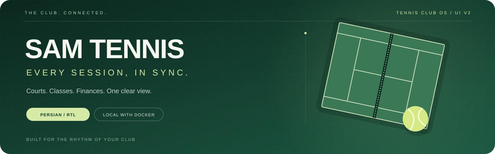
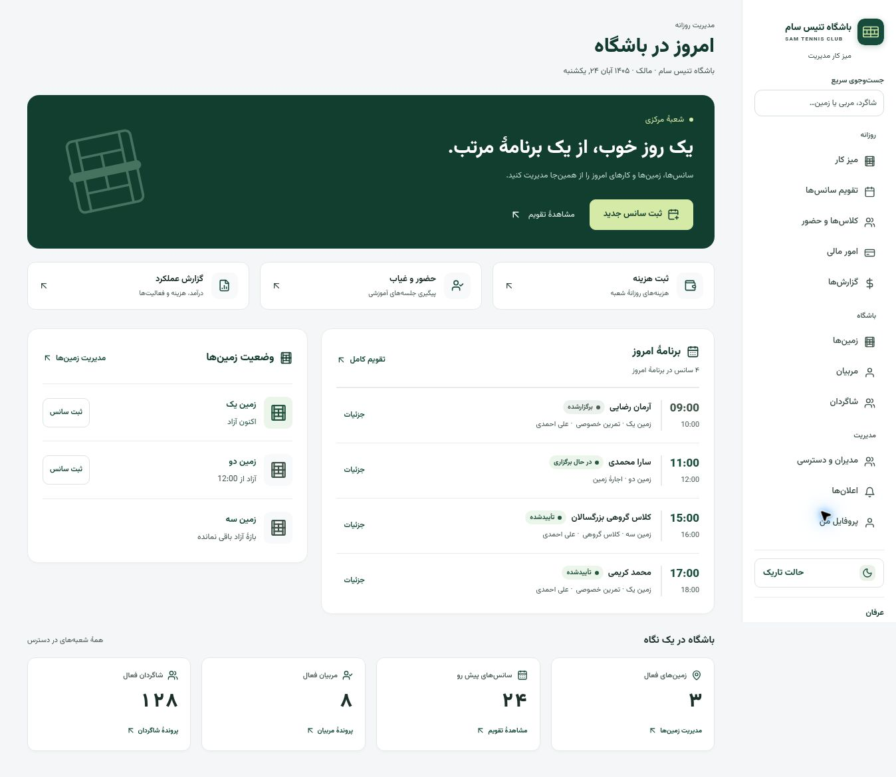
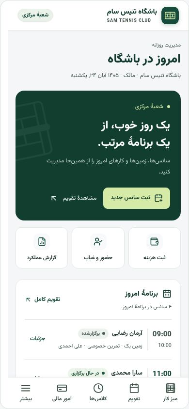
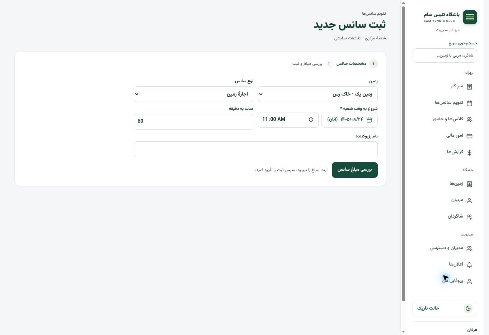
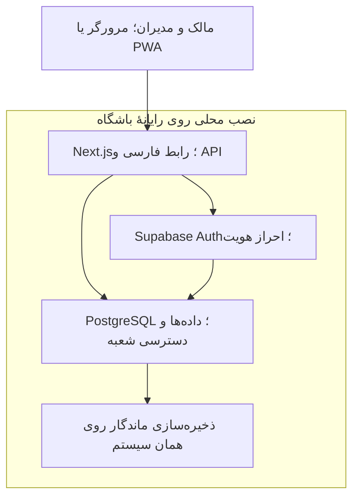

<div align="center">



<h1>باشگاه تنیس سام | Sam Tennis Club</h1>
<p><strong>از اولین سانس صبح تا تسویهٔ آخر ماه؛ نبض باشگاه در یک نگاه.</strong></p>
<p>مدیریت زمین و رزرو · کلاس و حضور · امور مالی · گزارش شعبه‌ها</p>

<p>
  <a href="#preview">نمای برنامه</a> ·
  <a href="#features">قابلیت‌ها</a> ·
  <a href="#latest-update">تغییرات نسخه</a> ·
  <a href="#quick-start">شروع سریع</a> ·
  <a href="#architecture">معماری</a> ·
  <a href="#guides">راهنماها</a> ·
  <a href="#english">English</a>
</p>

<p>
  
  
  
  
  
  
</p>

</div>

---

**یک باشگاه، چندین جریان کاری، یک میز کار.** سام برای مالک و مدیران شعبه ساخته شده است؛ برنامهٔ روز را ببینید، زمین آزاد پیدا کنید، سانس ثبت کنید و وضعیت کلاس‌ها و حساب‌ها را پیگیری کنید. همه در یک رابط فارسی، راست‌چین و متناسب با کار روزانهٔ باشگاه.

> **تمرکز روی کار بعدی:** ثبت سریع سانس، دسترسی مستقیم به هزینه و حضور، و نمایش روشن وضعیت زمین‌ها.

<a id="preview"></a>
## یک نگاه به سام

<div align="center">
  
  <p><sub>تصاویر نمای نسخهٔ ۲ را با دادهٔ نمونه نشان می‌دهند.</sub></p>
</div>

<table>
  <tr>
    <td width="32%" align="center" valign="top">
      <h3>همراه مدیر باشگاه</h3>
      
      <p>میز کار، تقویم، کلاس‌ها و مالی؛ در دسترس روی موبایل.</p>
    </td>
    <td width="68%" align="center" valign="top">
      <h3>از انتخاب زمین تا تأیید مبلغ</h3>
      
      <p>مشخصات سانس را وارد کنید، مبلغ را ببینید و ثبت را تأیید کنید.</p>
      <p><a href="docs/ui-v2/README.md">مشاهدهٔ جزئیات طراحی نسخهٔ دوم ←</a></p>
    </td>
  </tr>
</table>

<a id="features"></a>
## همهٔ کارهای باشگاه، کنار هم

<table>
  <tr>
    <td width="50%" valign="top">
      <h3>🎾 زمین‌ها و سانس‌ها</h3>
      <p>تعریف زمین، ساعات کاری، تعرفه، تعطیلی و تعمیرات. ثبت، جابه‌جایی و لغو رزرو در تقویم تعاملی روزانه، هفتگی و ماهانه.</p>
    </td>
    <td width="50%" valign="top">
      <h3>📅 میز کار روزانه</h3>
      <p>برنامهٔ امروز، وضعیت زمین‌ها، زمان آزاد بعدی و میانبرهای ثبت سانس، هزینه، حضور و گزارش؛ با جست‌وجوی سریع پرونده‌ها.</p>
    </td>
  </tr>
  <tr>
    <td valign="top">
      <h3>👥 مربیان، شاگردان و کلاس‌ها</h3>
      <p>پروندهٔ افراد، ظرفیت کلاس و ثبت حضور، تأخیر، غیبت یا انصراف. ماندهٔ بدهی و وضعیت بستهٔ آموزشی در پروندهٔ شاگرد دیده می‌شوند.</p>
    </td>
    <td valign="top">
      <h3>💳 امور مالی شعبه</h3>
      <p>فاکتور، دریافت، بازپرداخت، هزینه، بسته‌های آموزشی و تسویهٔ مربی؛ همراه خروجی CSV فاکتورها و فهرست کلاس.</p>
    </td>
  </tr>
  <tr>
    <td valign="top">
      <h3>📊 گزارش عملکرد</h3>
      <p>اشغال زمین، حضور شاگردان، تدریس مربیان و گردش مالی در بازه‌های روزانه تا سالانه یا دلخواه؛ با خروجی Excel و نمای چاپ برای PDF.</p>
    </td>
    <td valign="top">
      <h3>📱 تجربهٔ فارسی روی هر نمایشگر</h3>
      <p>تاریخ شمسی، فونت محلی وزیرمتن، تم روشن و تیره، ناوبری موبایل، مرکز اعلان‌ها و نصب PWA با اعلان اختیاری Web Push.</p>
    </td>
  </tr>
</table>

### یک روز کاری با سام

| زمان کار | اقدام شما | جایی که کمک می‌کند |
| --- | --- | --- |
| شروع روز | مرور سانس‌ها و زمین‌های آزاد | میز کار و تقویم |
| تماس برای رزرو | انتخاب زمین، زمان و نوع سانس؛ بررسی مبلغ | ثبت سانس |
| برگزاری کلاس | ثبت حضور و وضعیت شاگردان | کلاس‌ها و حضور |
| کارهای مالی | ثبت دریافت، هزینه و تسویه | امور مالی شعبه |
| مرور عملکرد | بررسی فعالیت‌ها و دریافت خروجی | گزارش‌ها |

ورود به سامانه مخصوص **مالک و مدیران** است. مربیان و شاگردان پروندهٔ مدیریتی دارند و حساب ورود ندارند.

<a id="latest-update"></a>
## تغییرات این نسخه

- **تاریخ شمسی** در تقویم سانس‌ها، کلاس‌ها، فیلتر مالی و گزارش‌ها. انتخابگر تاریخ از اسفند کبیسه و محدودیت بازهٔ مجاز پشتیبانی می‌کند.
- **پروندهٔ مالی شاگرد** با ماندهٔ بدهی از فاکتورهای مرتبط و تعداد جلسات مصرف‌شده و باقی‌ماندهٔ بستهٔ آموزشی.
- **تأیید عملیات حساس** در بخش‌هایی مانند ابطال هزینه و لغو سانس. فرم‌های به‌روزشده پس از ثبت، نتیجه را بدون بارگذاری کامل صفحه نشان می‌دهند.
- **نمای موبایل و PWA** با نمایش شعبهٔ انتخاب‌شده، جست‌وجوی بهتر، صفحه‌های خطای فارسی و نمایش خطای اتصال هنگام پایان مهلت بررسی سرور.
- **لایهٔ سرور** با کاهش بعضی پرس‌وجوهای تکراری، اعتبارسنجی درخواست‌ها و هماهنگی تمدید هم‌زمان نشست. GitHub Actions هم آزمون و ساخت نسخهٔ تولیدی را اجرا می‌کند.

<a id="quick-start"></a>
## باشگاه را راه بیندازید

### اجرا روی مک و ویندوز بدون Docker

۱. PostgreSQL 17 را یک‌بار نصب کنید. بستهٔ سام، برنامه، Node.js و سرویس ورود را همراه دارد.

| سیستم | بستهٔ GitHub Actions | فایل اجرا |
| --- | --- | --- |
| مک Apple Silicon، از جمله M1 | `Sam-Tennis-macos-arm64` | `Start-Sam-Tennis.command` |
| مک Intel | `Sam-Tennis-macos-x64` | `Start-Sam-Tennis.command` |
| ویندوز ۶۴ بیتی | `Sam-Tennis-windows-x64` | `Start-Sam-Tennis.bat` |

۲. در اجرای موفق مربوط به نسخهٔ موردنظر، بسته را از بخش **Artifacts** دریافت و هر دو لایهٔ ZIP را استخراج کنید. فایل اجرا را باز کنید و گزینهٔ اجرا را بزنید. [دریافت بسته‌ها](https://github.com/erfand39/tennis-club-os/actions/workflows/desktop-packages.yml)

۳. مرورگر روی `127.0.0.1:3030` باز می‌شود. اگر پورت اشغال باشد، راه‌انداز از ۳۰۳۱ استفاده می‌کند. هنگام نصب تازه، کد ساخت حساب مالک در همان پنجرهٔ اجرا نمایش داده می‌شود. [راهنمای گام‌به‌گام](docs/desktop.md)

**انتقال داده میان مک و ویندوز.** در سیستم مبدأ گزینهٔ «خروجی اطلاعات» را بزنید و فایل `.dump` را منتقل کنید. در مقصد «ورود اطلاعات» را بزنید و پس از بازیابی با حساب قبلی وارد شوید. بازیابی پس از اعتبارسنجی فایل، دیتابیس واردشده را فعال می‌کند. دیتابیس قبلی مقصد برای بازگشت با `rollback` در دسترس است. فایل خروجی نصب Docker از دستور `./scripts/local.sh backup` هم قابل ورود است. [راهنمای انتقال و بازگشت](docs/desktop.md#انتقال-اطلاعات)

### ۱. اجرا روی مک با Docker

Docker Desktop را نصب و باز کنید، سپس در Terminal اجرا کنید:

```sh
git clone https://github.com/erfand39/tennis-club-os.git
cd tennis-club-os
./scripts/local.sh up
./scripts/local.sh setup-code
```

### ۲. ساخت حساب مالک

[پنل محلی را باز کنید →](http://127.0.0.1:3030) کد نصب را وارد کنید و حساب مالک، مجموعه و شعبهٔ مرکزی را بسازید. نصب تازه با پایگاه دادهٔ خالی شروع می‌شود. اجرای اول برای دریافت تصاویر Docker و وابستگی‌ها به اینترنت نیاز دارد.

### ۳. آماده‌سازی اولین سانس

زمین‌ها، ساعات کاری و تعرفه را تنظیم کنید. برای سانس آموزشی، پروندهٔ مربی و شاگرد را نیز ثبت کنید؛ سپس از میز کار وارد **ثبت سانس جدید** شوید.

<details>
<summary><strong>پورت ۳۰۳۰ اشغال است؟</strong></summary>

در **اولین راه‌اندازی** به‌جای دستور `up` از دستور زیر استفاده کنید:

```sh
SAM_LOCAL_PORT=3031 ./scripts/local.sh up
```

سپس [پنل را روی پورت ۳۰۳۱](http://127.0.0.1:3031) باز کنید.

</details>

<details>
<summary><strong>دستورهای روزمره و به‌روزرسانی</strong></summary>

| کار | دستور |
| --- | --- |
| شروع با نسخهٔ نصب‌شده | `./scripts/local.sh start` |
| توقف با حفظ داده‌ها | `./scripts/local.sh stop` |
| وضعیت سرویس‌ها | `./scripts/local.sh status` |
| مشاهدهٔ لاگ | `./scripts/local.sh logs` |
| تهیهٔ پشتیبان | `./scripts/local.sh backup` |
| ساخت و اجرای سورس به‌روزشده | `./scripts/local.sh up` |

برای دریافت نسخهٔ جدید، روی شاخهٔ `main` و با پوشهٔ کاری تمیز، `git pull origin main` را اجرا کنید؛ سپس `./scripts/local.sh up` را بزنید.

</details>

[راهنمای کامل نصب و اجرا](docs/local-run.md) · [پشتیبان و بازیابی](docs/recovery.md) · [نصب روی گوشی](docs/pwa.md)

<a id="architecture"></a>
## پشت صحنهٔ باشگاه



| لایه | فناوری و نقش |
| --- | --- |
| رابط | Next.js 16، React 19، TypeScript؛ راست‌چین، وزیرمتن و تاریخ شمسی |
| تعامل و نمایش | Lucide، Motion و اجزای اختصاصی برنامه |
| داده | PostgreSQL؛ اطلاعات باشگاه، سانس‌ها، کلاس‌ها و عملیات مالی |
| احراز هویت | Supabase Auth محلی، با بررسی نقش مالک و مدیر شعبه |
| اجرا | راه‌انداز بومی روی مک و ویندوز یا Docker Compose |
| موبایل | PWA و Web Push اختیاری |

### اطلاعات، همراه نصب شما

- در نصب بومی، اطلاعات باشگاه در پوشهٔ دادهٔ حساب سیستم ذخیره می‌شوند. در نصب Docker، اطلاعات در حجم ماندگار PostgreSQL و تنظیمات در `.local/secrets.env` قرار دارند.
- اجرای محلی به حساب Supabase Cloud نیاز ندارد. نشانی پیش‌فرض فقط روی رایانهٔ میزبان باز می‌شود.
- استفاده از آیفون یا دستگاه دیگر در شبکهٔ باشگاه به HTTPS خصوصی و معتبر نیاز دارد؛ جزئیات در [راهنمای PWA](docs/pwa.md) آمده است.
- حالت آفلاین راهنمای عمومی نمایش می‌دهد؛ ثبت رزرو و عملیات مالی به اتصال سرور نیاز دارند.
- برای انتقال به نصب بومی از فایل پشتیبان `.dump` استفاده کنید. در مسیر بازیابی Docker، کلیدهای همان نصب را هم طبق راهنما نگه دارید. [راهنمای انتقال بومی](docs/desktop.md#انتقال-اطلاعات) · [راهنمای بازیابی Docker](docs/recovery.md)

<a id="guides"></a>
## مسیرتان را پیدا کنید

| می‌خواهید… | از اینجا شروع کنید |
| --- | --- |
| برنامه را نصب یا به‌روز کنید | [مک و ویندوز بدون Docker](docs/desktop.md) · [نصب با Docker](docs/local-run.md) |
| زمین، مربی و شاگرد تعریف کنید | [مدیریت پرونده‌ها و منابع](docs/resource-management.md) |
| رزرو و زمان‌بندی را مدیریت کنید | [تقویم و سانس‌ها](docs/calendar.md) |
| کلاس و حضور را ثبت کنید | [کلاس‌ها و حضور](docs/classes.md) |
| حساب‌های شعبه را پیگیری کنید | [امور مالی](docs/finance.md) |
| عملکرد باشگاه را تحلیل کنید | [گزارش‌های مدیریتی](docs/reports.md) |
| برنامه را روی گوشی نصب کنید | [PWA و اعلان‌ها](docs/pwa.md) |
| ساختار فنی را بشناسید | [معماری](docs/architecture.md) · [مدل داده](docs/data-model.md) |
| طراحی و تصاویر را ببینید | [ظاهر نسخهٔ دوم](docs/ui-v2/README.md) · [سیستم طراحی](docs/design-system.md) |
| آمادگی انتشار را بررسی کنید | [آمادگی انتشار](docs/release-readiness.md) · [سناریوهای آزمون](tests/e2e) |

<details>
<summary><strong>برای توسعه‌دهندگان؛ اجرا و بررسی کد</strong></summary>

از **Node.js 24 و npm** استفاده کنید:

```sh
npm ci
npm run typecheck
npm test
npm run build
```

برای اجرای توسعه، پس از تنظیم سرویس‌ها و متغیرهای محیطی مطابق راهنمای پروژه:

```sh
npm run dev
```

آزمون‌های پایگاه داده و نصب کامل به محیط آزمایشی جدا نیاز دارند. مجموعهٔ E2E فعلی در حالت پیش‌فرض از سرور شبیه‌سازی‌شده استفاده می‌کند؛ قبولی آن جای بررسی جریان‌های واقعی رزرو و مالی روی سرویس‌های آزمایشی را نمی‌گیرد.

</details>

### پیشنهاد یا ایرادی دارید؟

در [Issues](https://github.com/erfand39/tennis-club-os/issues) بنویسید چه کاری انجام دادید، چه انتظاری داشتید و چه اتفاقی افتاد. اطلاعات واقعی اعضا، کلیدها و فایل پایگاه داده را در گزارش عمومی قرار ندهید.

<details>
<summary><strong>تاریخچهٔ نسخهٔ دوم</strong></summary>

این مخزن، مرجع رسمی توسعه است. نسخهٔ ۲ برنامه در [PR #12](https://github.com/erfand39/tennis-club-os/pull/12) ادغام شد و بازطراحی داشبورد و ناوبری در [PR #13](https://github.com/erfand39/tennis-club-os/pull/13) به `main` پیوست. تاریخچهٔ مستقل قبلی در [sam-tenis-2](https://github.com/erfand39/sam-tenis-2) در دسترس است.

</details>

---

<a id="english"></a>
## English

**Sam Tennis Club** is a Persian-first club management application for owners and branch administrators, with court bookings, classes, attendance, branch finances and performance reports.

- Daily dashboard with court availability and quick booking actions
- Interactive day, week and month calendars with Jalali date selection in scheduling and reports
- Coach and student records, class capacity and attendance
- Invoices, receipts, refunds, expenses, training packages and coach settlements, with student balances and remaining sessions on each student record
- Excel reports, CSV exports and print views for PDF
- Persian RTL interface, Jalali dates, light/dark themes and mobile navigation
- Native macOS and Windows packages with a portable PostgreSQL backup, alongside Docker deployment
- Installable PWA with optional Web Push; operational writes require a server connection

Install PostgreSQL 17, extract the desktop package for your system, and open `Start-Sam-Tennis.command` on macOS or `Start-Sam-Tennis.bat` on Windows. Use the launcher menu to export or import a `.dump` when moving between systems. [Desktop setup and downloads](docs/desktop.md)

[Setup guide (Persian)](docs/local-run.md) · [Architecture](docs/architecture.md) · [UI v2 showcase](docs/ui-v2/README.md)

---

<div align="center">
  
  <p><strong>باشگاه تنیس سام</strong></p>
  <p>زمان کمتر برای مدیریت؛ تمرکز بیشتر روی زمین.</p>
  <sub>SAM TENNIS CLUB · EVERY SESSION, IN SYNC.</sub>
</div>
