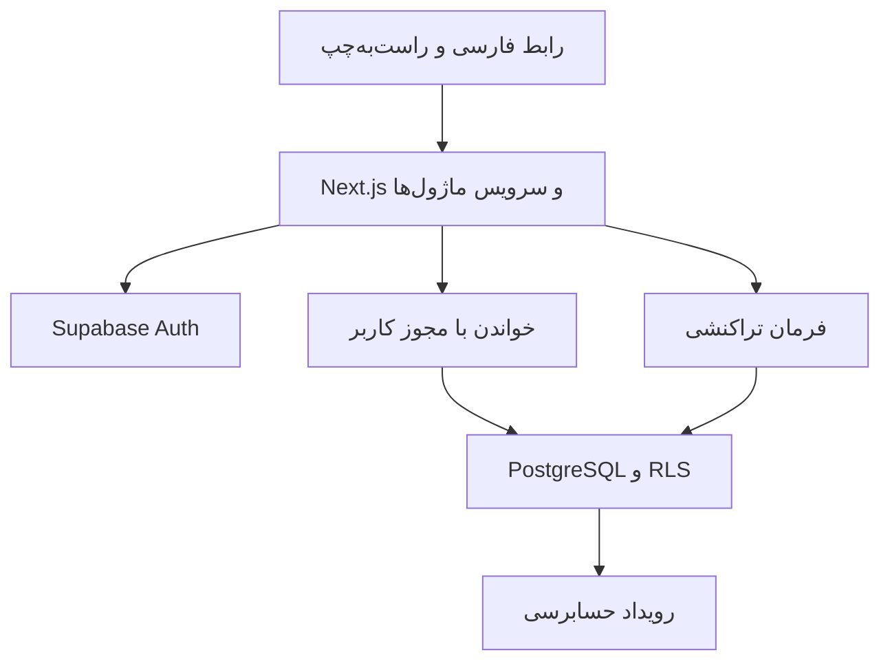

# معماری

## لایه‌ها

Tennis Club OS یک سامانهٔ یکپارچهٔ ماژولار است. Next.js App Router و TypeScript با حالت strict برای رابط و لایهٔ سرور، و Supabase Auth و PostgreSQL برای هویت و داده پیشنهاد می‌شوند. صفحه و دادهٔ اولیه در سرور آماده می‌شوند. تقویم، فرم و نمودار بخش‌های تعاملی سمت کاربرند. Route Handler یا Server Action فرمان را به سرویس همان ماژول می‌رساند. اعتبارسنجی و تبدیل خطای دامنه در مرز سرور انجام می‌شود و تضمین هم‌زمانی و اتمی‌بودن در پایگاه داده قرار می‌گیرد.

| ماژول | مالک مسئولیت | وابستگی عملیاتی |
| --- | --- | --- |
| هویت و دسترسی | ورود، عضویت مجموعه، نقش و شعبه | Supabase Auth، ساختار مجموعه |
| مجموعه و شعبه | اطلاعات مجموعه، ساعات و تقویم شعبه، تنظیمات | هویت برای اعمال مجوز |
| زمین | وضعیت، ساعات اختصاصی و انسداد | شعبه، زمان‌بندی برای جلوگیری از انسداد متداخل |
| مربی | پرونده، شعبه‌های مجاز، برنامهٔ کاری | عضویت اختیاری برای ورود |
| شاگرد | پرونده، سطح و وضعیت ثبت‌نام | عضویت اختیاری برای پنل آینده |
| برنامه و کلاس | دوره، جلسه، ظرفیت و شرکت‌کننده | مربی، شاگرد و رزرو |
| رزرو و تقویم | زمان، تخصیص منابع، لغو و جابه‌جایی | زمین، افراد، تعرفه و شعبه |
| حضور و غیاب | حضور فرد و زمان واقعی برگزاری | جلسه و فهرست شرکت‌کنندگان |
| تعرفه و مالی | قیمت، فاکتور، دریافت و بازپرداخت. بسته و تسویه در ادامه | رزرو و شعبه، ثبت رویداد مالی |
| گزارش | خواندن داده، تعریف KPI، ریز سوابق و خروجی در مراحل بعد | رزرو، ساعات، جلسه، حضور و مالی |
| اعلان، حسابرسی و تنظیمات | رویدادهای حساس، صف ارسال در فاز اعلان، ترجیحات و سیاست‌ها | ثبت در تراکنش عملیات مرتبط |

## جریان رزرو و دریافت

1. کاربر شعبه، تاریخ محلی، بازه و نوع سانس را انتخاب می‌کند. سرور تاریخ و ساعت را به زمان استاندارد تبدیل و عضویت فعال و مجوز شعبه را بررسی می‌کند.
2. فرمان رزرو در یک تراکنش ساعت کاری، وضعیت زمین و افراد، تعرفه و ظرفیت را کنترل می‌کند. قیدهای پایگاه داده تعارض نهایی را در برابر درخواست هم‌زمان تشخیص می‌دهند.
3. رزرو، تخصیص زمین و افراد، مبلغ قطعی و رویداد حسابرسی هم‌زمان ذخیره می‌شوند. در رزرو آموزشی، جلسه و ثبت‌نام‌های اولیه نیز در همان تراکنش ساخته می‌شوند. فرایند اجاره بدون جلسهٔ آموزشی معتبر است.
4. فاکتور می‌تواند در جریان رزرو صادر شود. در صورت صدور هم‌زمان، فاکتور و اقلام آن بخشی از همان فرمان هستند. دریافت جداگانه روی فاکتور ثبت می‌شود و وضعیت مانده به‌روز می‌شود.
5. تقویم پاسخ سرور را می‌خواند. گزارش، برنامه را از رزرو، برگزاری را از جلسه و حضور، و وجه وصول‌شده را از عملیات مالی محاسبه می‌کند.

بازهٔ تخصیص `[start, end)` است. سه جدول تخصیص زمین، مربی و شاگرد با قید `EXCLUDE USING gist` روی سازمان، شناسهٔ منبع و تداخل `tstzrange` طراحی می‌شوند. نصب و امکان استفاده از `btree_gist` برای عملگر برابری شناسه‌ها در محیط هدف در فاز ۰۲ بررسی می‌شود. تعمیرات و انسداد موردی در جدول تخصیص زمین ثبت می‌شوند تا رزرو و تعمیرات از همان قید عبور کنند. تعطیلی شعبه و تغییر ساعت مؤثر با همان پروتکل تغییر برنامهٔ منابع، رزروهای آیندهٔ تحت تأثیر را بررسی می‌کنند. آزادسازی تخصیص و تغییر وضعیت رزرو یا جلسه در یک تراکنش انجام می‌شود. اگر یک شرکت‌کننده به جلسه اضافه شود، سطر جلسه برای کنترل ظرفیت قفل و تخصیص شاگرد نیز درج می‌شود. جابه‌جایی، لغو، تغییر ظرفیت، تغییر ساعات مؤثر و غیرفعال‌سازی با پروتکل مشترک قفل منابع و بررسی دوبارهٔ وضعیت طراحی می‌شوند. ترتیب دریافت قفل منابع ثابت است. موارد پایان و آغاز در لحظهٔ برابر و تعارض بین دو شعبه برای مربی یا شاگرد مشترک در تست هم‌زمانی پوشش داده می‌شوند. [مستند PostgreSQL](https://www.postgresql.org/docs/current/rangetypes.html#RANGETYPES-CONSTRAINT)

فرمان حساس شناسهٔ درخواست پایدار دارد. ثبت شناسه، هش ورودی و نتیجهٔ قابل بازیابی با تغییرات فرمان در یک تراکنش است. تکرار همان ورودی همان نتیجه را می‌دهد. استفاده از همان شناسه با ورودی متفاوت خطاست. در قطع اتصال، کاربر وضعیت فرمان قبلی را بررسی می‌کند و همان شناسه را برای تلاش دوباره به کار می‌برد. پرداخت و بازپرداخت روی فاکتور مربوط هم‌زمان بررسی و ثبت می‌شوند تا اضافه‌پرداخت یا بازپرداخت مازاد ایجاد نشود.

## امنیت، داده و محیط‌ها

- `organization_id` در دادهٔ عملیاتی و `location_id` در دادهٔ شعبه‌ای قرار می‌گیرد. کلیدهای خارجی مرکب ثبت ارتباط اشتباه میان سازمان یا شعبه را در پایگاه داده رد می‌کنند.
- احراز هویت در Auth و اختیار عملیاتی در عضویت معتبر پایگاه داده بررسی می‌شود. RLS و مجوزهای جدول یا تابع هر دو بررسی می‌شوند. کلید مدیریتی سمت سرور محدود می‌ماند. جداول داخلی حسابرسی و هماهنگی فرمان از سطح عمومی API خارج‌اند. [مستند RLS](https://supabase.com/docs/guides/database/postgres/row-level-security) · [امن‌سازی Data API](https://supabase.com/docs/guides/api/securing-your-api)
- تابع‌های عمومی فقط عملیات لازم و مجوز حداقلی دارند. حالت پیش‌فرض `SECURITY INVOKER` است. در صورت نیاز به تابع دارای اختیار اضافه، بدنه در schema داخلی قرار می‌گیرد و هویت، سازمان و اختیار عملیات را بررسی می‌کند. مسیر اجرای تابع، مجوز EXECUTE و سیاست هر view پیش از انتشار بازبینی می‌شود.
- رابط برای خطا پیام فارسی قابل اقدام و در خطاهای سیستمی شناسهٔ پیگیری دارد. رویداد عملیاتی شناسهٔ عامل، نوع تغییر، موجودیت و زمان را نگه می‌دارد. توکن، رمز، دادهٔ خام پرداخت و دادهٔ غیرضروری مخاطب از رخداد و لاگ حذف می‌شوند.
- هر شعبه منطقهٔ زمانی مشخص دارد. بازهٔ جست‌وجوی گزارش با مرز روزهای محلی به بازهٔ زمانی استاندارد تبدیل می‌شود. اگر تغییر منطقهٔ زمانی لازم شود، سیاست اثر آن روی برنامه و گزارش گذشته قبل از اجرا مشخص می‌شود. در نسخهٔ اولیه تغییر منطقهٔ زمانی پس از ثبت عملیات نیازمند فرایند کنترل‌شده است.
- محیط‌های توسعه، آزمایشی و عملیاتی جدا هستند. مهاجرت‌ها و نمونه‌دادهٔ آزمایشی نسخه‌دارند. پیش از استقرار، بازیابی نسخهٔ پشتیبان در محیط آزمایش تمرین می‌شود. نسخهٔ ابزارها همراه پیاده‌سازی و اجرای واقعی قفل و ثبت می‌شود. [ساختار Next.js](https://nextjs.org/docs/app/getting-started/project-structure) · [ورود سمت سرور Supabase](https://supabase.com/docs/guides/auth/server-side/nextjs) · [تغییرات CLI](https://supabase.com/changelog/supabase-cli-v3)

## گردش تغییرات در GitHub

هر مرحله با خواندن وضعیت شاخهٔ `main` و سند وضعیت آغاز می‌شود. تغییرات هم‌بسته با پیام روشن در یک commit ثبت می‌شوند. در تغییرات کد، بررسی نوع، ساخت و تست‌های مرتبط قبل از ادغام یا به‌روزرسانی شاخه اجرا می‌شوند. مهاجرت، نتیجهٔ تست، وضعیت انتشار و موارد باز در همان مرحله مستند می‌شوند. در صورت تغییر هم‌زمان شاخه، ابتدا تغییرات جدید بررسی و با کار فعلی ادغام می‌شوند. فایل‌های محیطی واقعی، کلیدها و دادهٔ باشگاه خارج از Git می‌مانند.
