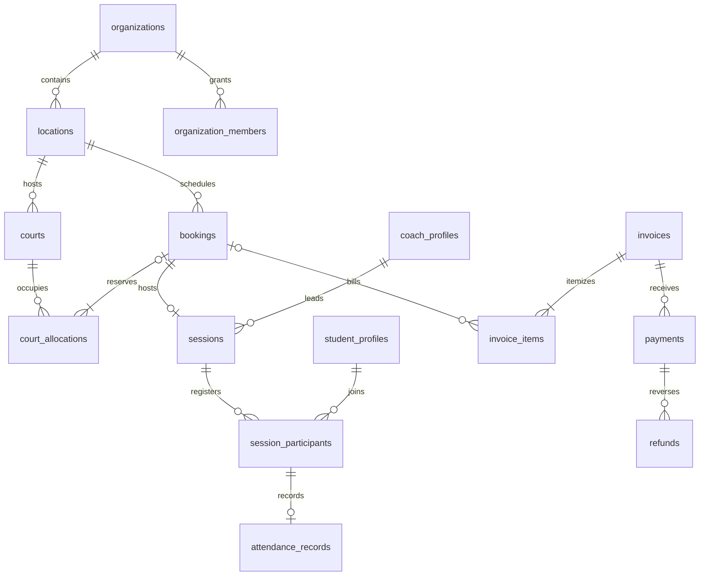

# مدل دادهٔ اولیه

نمودار ارتباط‌های اصلی را نشان می‌دهد. فرهنگ داده، جدول‌های پشتیبان و روابط شعبه را نیز پوشش می‌دهد. نام‌ها پیش از نخستین مهاجرت نهایی می‌شوند.

در نمودار، تخصیص تعمیرات به رزرو وصل نیست. یک رزرو تأییدشده دقیقاً یک تخصیص فعال زمین دارد. سابقهٔ جابه‌جایی و لغو از رویدادها قابل بازخوانی است. فاکتور می‌تواند شامل چند قلم مربوط به رزرو باشد. هر قلم رزرو در نسخهٔ اولیه حداکثر یک بار به‌صورت مؤثر صورتحساب می‌شود.

## فرهنگ داده

کلیدهای اصلی شناسهٔ پایدار دارند. دامنهٔ داده در جدول مشخص است. نوع شناسه، محدودیت nullable، مقادیر وضعیت و سیاست RLS در فاز مهاجرت به قرارداد اجرایی تبدیل می‌شوند.

| گروه و جدول | دادهٔ اصلی | مالکیت، تاریخچه و دسترسی |
| --- | --- | --- |
| `organizations` و `locations` | نام، وضعیت، منطقهٔ زمانی شعبه، واحد پول مجموعه و تنظیمات گزارش | مالک و مدیر؛ انتخاب شعبه بر اساس عضویت |
| `profiles`، `organization_members` و `member_locations` | حساب Auth، نقش سازمانی، وضعیت، شعبه‌های مجاز | فرد برای اطلاعات محدود خودش و مدیر مجاز برای عضویت. دادهٔ هویتی سراسری با دادهٔ عملیاتی سازمان جدا می‌شود. |
| `courts` | شعبه، نام، سطح، وضعیت، تاریخ شروع و پایان بهره‌برداری | شعبه. آرشیو و تغییر وضعیت با تاریخ اثر و رویداد. |
| `court_operating_hours` و `location_closures` | برنامهٔ محلی، روز هفته، ساعات و بازهٔ اعتبار، تعطیلی شعبه | شعبه. نسخه‌بندی ساعت کاری برای بازتولید گزارش تاریخی. |
| `court_allocations` | زمین، `tstzrange`، نوع رزرو، تعمیرات یا انسداد، شناسهٔ رزرو در صورت وجود، علت و وضعیت اثر | شعبه. قید تداخل مشترک برای تمام تخصیص‌های مؤثر. |
| `coach_profiles`، `coach_locations` و `coach_availability` | نام، تخصص، وضعیت، شعبه‌ها، زمین‌های مجاز و ساعات کاری | سازمان. مربی با هویت واحد در شعبه‌های مجاز شناخته می‌شود. |
| `student_profiles` و `student_locations` | نام، اطلاعات تماس لازم، سطح، وضعیت و شعبه‌های مجاز | سازمان. کاربر شعبه‌ای فقط اطلاعات لازم برای کار در همان شعبه را می‌بیند. |
| `pricing_rules` | بازهٔ اعتبار، شاخهٔ تعرفه، مدت، مبلغ و واحد | شعبه. مبلغ رزرو از نسخهٔ تعرفه در لحظهٔ تأیید ثبت می‌شود. |
| `bookings` و `booking_events` | نوع سانس، زمان محلی مشتق‌شده از بازهٔ استاندارد، زمین، رزروکننده، مبلغ قطعی، تغییرات و علت | شعبه. رویداد تغییر، بازهٔ قبلی و جدید و عامل را ثبت می‌کند. |
| `programs`، `sessions` و `session_participants` | دورهٔ اختیاری، رزرو، نوع کلاس، مربی، ظرفیت، ثبت‌نام و زمان واقعی برگزاری | شعبه. جلسهٔ مستقل بدون دوره معتبر است. تکرار شرکت‌کننده در یک جلسه رد می‌شود. |
| `coach_allocations` و `student_allocations` | شناسهٔ منبع، شناسهٔ جلسه یا ثبت‌نام، بازه، وضعیت اثر | سازمان برای قید تداخل بین شعبه‌ها. مشاهده بر اساس شعبه و نقش محدود می‌شود. |
| `attendance_records` | ثبت‌نام، وضعیت، زمان ثبت، ثبت‌کننده، یادداشت لازم | شعبه. هر ثبت‌نام حداکثر یک وضعیت جاری و رویدادهای اصلاح دارد. |
| `invoices`، `invoice_items`، `payments` و `refunds` | مبلغ به واحد پایه، واحد پول، فاکتور، تاریخ مؤثر، مرجع و قلم مربوط به رزرو | شعبه. ثبت قطعی و عملیات جبرانی قابل ردیابی‌اند. جمع دریافت و بازپرداخت همراه با قفل فاکتور بررسی می‌شود. |
| `audit_logs` و `operation_requests` | عامل، عملیات، زمان، شناسهٔ هدف، شناسهٔ درخواست، هش ورودی و نتیجه | سازمان، schema داخلی و دسترسی محدود. پیام‌های خطا و لاگ‌های خارج از پایگاه داده اطلاعات حساس ندارند. |
| بسته‌ها، عضویت‌ها، هزینه‌ها و تسویه | تعداد جلسه و گردش مصرف، قرارداد دوره‌ای، هزینه و تسویهٔ مربی | مرحلهٔ بعدی. با اسناد مالی، شاگرد، مربی و شعبه مرتبط می‌شوند. |
| اعلان، صف ارسال و گزارش تجمیعی | رخداد، گیرنده، وضعیت ارسال، بازه و زمان تازگی در صورت نیاز | مرحلهٔ بعدی. دورهٔ نگهداری و سیاست نوسازی قبل از استفاده تعیین می‌شود. |

## قواعد زمان، مبلغ و تاریخچه

- زمان رخدادها با `timestamptz` و بازه با `tstzrange` ذخیره می‌شود. برنامهٔ هفتگی ساعت محلی، روز هفته، منطقهٔ زمانی و بازهٔ اعتبار دارد. پایان نیمه‌شب به‌صورت مرز روز بعد تفسیر می‌شود.
- مبلغ صحیح با نوع دقیق پایگاه داده و واحد پول ثبت می‌شود. در مرز API عدد بزرگ به‌صورت رشتهٔ ده‌دهی جابه‌جا می‌شود. در مثال با واحد پایهٔ IRR، مبلغ ۹٬۰۰۰ ریال برابر با ۹۰۰ تومان است. مبالغ با واحدهای مختلف جمع نمی‌شوند. نسبت و گردکردن، بخشی از قرارداد هر تعرفه است.
- ساعت کاری، تعطیلی، تعمیرات، قیمت قطعی و سابقهٔ جابه‌جایی دادهٔ تاریخی‌اند. گزارش تاریخی از بازه و وضعیت مؤثر استفاده می‌کند. گزارش برنامه بر اساس وضعیت فعلی رزروها اجرا می‌شود. بازسازی گزارش در تاریخ مشاهدهٔ گذشته و نسخه‌های ثابت گزارش قابلیت بعدی است.
- مبنای یکتایی و ایندکس با مسیرهای مصرف تعریف می‌شود. نمونه‌ها شامل عضویت فعال سازمان و کاربر، تقویم شعبه و بازه، رزروهای زمین و تاریخ، و دریافت‌ها بر اساس شعبه و تاریخ مؤثر هستند. ایندکس‌های نهایی با دادهٔ آزمایشی و طرح اجرای کوئری بررسی می‌شوند.
