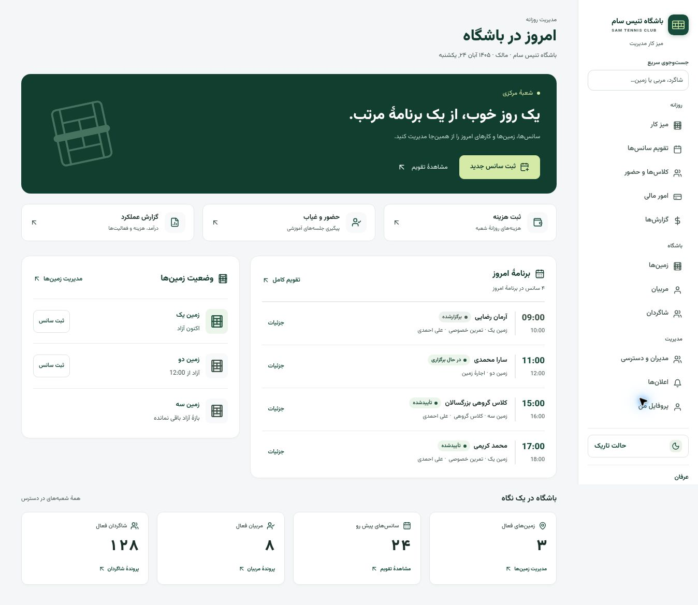

# نسخهٔ دوم ظاهر باشگاه تنیس سام

بازطراحی روی نسخهٔ `f5167b6` شاخهٔ اصلی انجام شده است. داشبورد و پوستهٔ برنامه از دریافت داده جدا شده‌اند تا رابط با همان داده‌های مجاز و مسیرهای موجود نمایش داده شود.

## تغییرات

| بخش | نتیجه |
| --- | --- |
| داشبورد | ثبت سانس برجسته، میانبر هزینه و حضور و گزارش، فهرست ساعت‌دار سانس‌ها، وضعیت زمین‌ها و آمار با محدودهٔ مشخص |
| ناوبری دسکتاپ | منوی ثابت و قابل اسکرول با سه گروه روزانه، باشگاه و مدیریت |
| ناوبری موبایل | دسترسی مستقیم به میز کار، تقویم، کلاس‌ها و مالی؛ بخش‌های دیگر در منوی بیشتر |
| منوی بیشتر | پنجرهٔ بومی `dialog`، غیرفعال شدن محتوای پشت پنجره، گردش فوکوس، Escape و بازگشت فوکوس |
| فرم رزرو | مشخص‌کردن دو مرحلهٔ ورود اطلاعات و بررسی مبلغ؛ حفظ روند تأیید قیمت فعلی |
| ظاهر مشترک | زمینهٔ روشن، سطوح ساده، سبز تیره، فونت محلی وزیرمتن، کنترل‌های خوانا و حالت تیرهٔ انتخابی |
| حالت‌های خالی | اقدام مشخص برای ثبت اولین سانس و افزودن زمین |

## تصاویر

تصاویر از اجزای واقعی React با داده‌های نمونه گرفته شده‌اند؛ اطلاعات واقعی باشگاه نیستند. ابزار و مسیر موقت پیش‌نمایش در نسخهٔ تولیدی قرار ندارند.

[نمای موبایل](mobile.jpg) · [فرم ثبت سانس](booking.jpg)

## منابع و تصمیم طراحی

- [Vercel Web Interface Guidelines](https://github.com/vercel-labs/web-interface-guidelines): برچسب‌گذاری کنترل‌ها، فوکوس، لینک عبور به محتوا، حالت‌های خالی و کاهش حرکت.
- [shadcn/ui](https://github.com/shadcn-ui/ui) و [الگوی Sidebar](https://ui.shadcn.com/docs/components/sidebar): گروه‌بندی منو و سلسله‌مراتب سطوح و کنترل‌ها. وابستگی shadcn نصب نشده؛ الگو با اجزای فعلی پروژه تطبیق داده شده است.
- [UI UX Pro Max](https://github.com/nextlevelbuilder/ui-ux-pro-max-skill): جست‌وجوی طرح کلی ورزشی نتیجهٔ بازاریابی نامتناسب داد و استفاده نشد. جست‌وجوی محدودتر `minimal dashboard` در سبک‌های سازگار با RTL، الگوی Minimalism & Swiss Style را پیشنهاد کرد؛ خلوتی، شبکه‌بندی و کنتراست آن با هویت سبز سام تطبیق داده شد.

فونت و کتابخانهٔ آیکون موجود حفظ شده‌اند. این تغییر، مهاجرت دیتابیس یا تغییر API و منطق مالی ندارد.

## اعتبارسنجی

- `npm run typecheck`
- `npm run build`
- `npm run test:design` — ۱۱ آزمون
- `node --test scripts/theme.test.mjs` — ۴ آزمون
- `npm run test:pwa` — ۵ آزمون
- `npm run test:e2e` — ۱۲۸ آزمون موجود

بررسی مرورگر: داشبورد دسکتاپ، قاب‌های ۳۲۰، ۳۹۰ و ۷۶۸ پیکسل، نبود سرریز افقی در قاب‌های کوچک و تبلت، حالت خالی، تغییر نوع سانس، تم تیره، باز و بسته‌شدن منو، گردش فوکوس با Shift+Tab و بازگشت فوکوس بعد از Escape.

**محدودیت:** مجموعهٔ E2E فعلی در حالت پیش‌فرض از سرور شبیه‌سازی‌شده استفاده می‌کند. بررسی مرورگر نیز با دادهٔ نمونه انجام شد. ورود، ثبت رزرو و تراکنش مالی به‌صورت انتهابه‌انتها روی PostgreSQL و Supabase Auth واقعی در این محیط اجرا نشده‌اند. پیش از انتشار روی نصب باشگاه، همین جریان‌ها با حساب و پایگاه دادهٔ آزمایشی معتبر بررسی شوند.

## اجرا روی نصب محلی

پس از دریافت این شاخه، مطابق [راهنمای اجرای محلی](../local-run.md) سرویس را با `./scripts/local.sh up` دوباره بسازید. برای این بازطراحی وابستگی جدید یا تغییر تنظیمات نصب لازم نیست.
